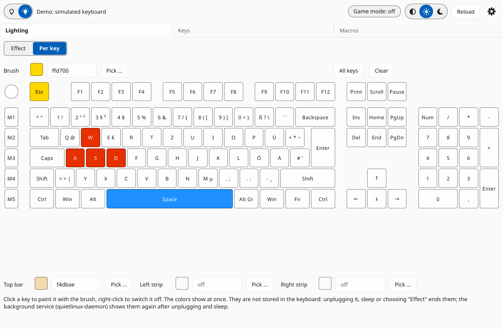

# Graphical interface

`quietlinux-gui` shows the keyboard and changes its lighting, key bindings and
macros. It uses the same library as the command line tool, so everything it
does is described in more detail in [usage-cli.md](usage-cli.md).

```sh
quietlinux-gui            # the connected Light Mount
quietlinux-gui --demo     # a simulated keyboard: try everything without changing yours
```

The window reads the keyboard when it opens and after every change (**Reload**
reads it again). While a change is being sent, the status line at the bottom
says "Working …"; errors appear there in red. The window does not watch key
presses.

The switch at the left of the title line turns the **lighting off and on**
(bulb off, bulb on): on shows the stored effect, or the painted keys if the
Lighting tab shows **Per key**. Next to it, a note appears when no keyboard is
connected or its firmware is untested (read-only).

The title line also shows whether **game mode** is on. Game mode is switched on the
keyboard with Fn+Pause, so the window asks for it every 2 seconds (a read-only
request; not while a change is being sent).

The switch next to **Reload** chooses the theme: the system's (half circle),
light (sun) or dark (moon); click a position. The choice is saved in
`~/.config/quietlinux/gui.toml`. The gear in the corner opens the
[settings](#settings).

On a firmware version QuietLinux was not tested with, every change is refused,
like the command line without `--allow-unknown-firmware`.

The window does not support screen readers yet (see [todo.md](todo.md)); the
command line tool does everything it does.

## Lighting

The switch at the top of the tab chooses what to edit: **Effect** (stored in the
keyboard) or **Per key** (colors for single keys). Choosing one shows it on
the keyboard at once: the stored effect, or the painted keys.

### Effect


- **Effect**, **Colors**, **Brightness**, **Speed** and **Direction** as in
  `quietlinux light effect`. Colors are six hex digits (`e63000`); "Rainbow" is
  IO Center's color gradient.
- With "Two colors", the reactive effect lights a pressed key in the first
  color ("Key press") on the second ("Background").
- **Pick …** (or a click on the swatch) opens a color wheel: the hue around
  the circle, pale colors towards the center; the slider below sets how bright
  the color is.
- **Direction** lists only the directions of the chosen effect (up, down,
  left, right for color wave and matrix; clockwise, counterclockwise for
  tornado) and is greyed out for static, breathing and reactive.
- **Every change applies at once** and is stored in the keyboard: a choice in a
  list, a slider, a color from the wheel (when you let go) or six typed hex
  digits. A short pause (0.4 s) after the last change keeps a drag from
  writing to the keyboard many times.
- The Light Mount does not report its effect. QuietLinux remembers the last
  effect it set (window or command line) in `~/.config/quietlinux/last-effect.toml`
  and fills the fields with it when the window opens. An effect set with IO
  Center is not known to it.

### Per key



Colors for single keys, like `quietlinux light set`:

- Choose the **Brush** color (hex digits or **Pick …**), then click keys to
  paint them; right-click switches a key off. **All keys** paints every key,
  **Clear** switches everything off.
- **Top bar**, **Left strip** and **Right strip** color the light bars;
  empty means off.
- Changes show on the keyboard at once (realtime mode).
- These colors are **not stored** in the keyboard: unplugging it ends them,
  and so does choosing **Effect** or applying an effect. The window remembers
  them (in `~/.config/quietlinux/lighting.toml`) and shows them again when it
  opens; painting a key sends them all to the keyboard again. The background
  service shows them again after replugging or sleep
  ([installation](installation.md#background-service-optional)).
- When the window opens, the Lighting tab shows **Per key** if the keyboard is
  in per-key mode, else **Effect**.

## Keys


Click a key to see what it does, normally and with Fn held. Keys with a
highlighted border are bound to something other than their factory binding;
such a key shows its binding ("F14", "Ctrl+C", "Mute", a macro's name, "off")
with its own legend small in the corner. Bindings of the Fn layer show when
you click the key.
The legends follow the layout the keyboard reports (German, UK or French ISO).

To change a key, choose the layer (**Normal** or **With Fn**; for the knob
**Press**, **Turn left** or **Turn right**), what it should do, and a value,
then **Apply**:

| Choice | Value |
|---|---|
| Factory binding | (none) |
| Key or combination | as in `bind KEY key`, e.g. `ctrl+KeyC`, `F13` |
| Media, Mouse button, Lighting | from the list |
| Macro | one of the macros stored in the keyboard |
| Website | `https://…` (at most 51 characters); opened by the [background service](installation.md#background-service-optional) |
| Disabled | (none) |

Fn cannot be bound. Enter can only be changed with the command line
(`quietlinux bind --force Enter …`), so that it is not changed by mistake.

## Macros


The list shows the macros stored in the keyboard. Select one to change its
name, repeat mode or events, then **Save**; **New macro** starts an empty one,
**Create** stores it. **Delete** is refused while a key is bound to the macro.

**Record** records the macro as you type it on the Light Mount (the keyboard's
own recording); **Stop** ends it (only with the mouse, so that typing cannot
press it). **Pauses** chooses the pause after each event: **None** (50 ms),
**Fixed** (set the ms) or **As recorded**; changing it after a recording
recalculates the events. The recording fills the events field; nothing is
stored until **Save** / **Create**. The typed keys also reach the window (the
text fields are locked meanwhile).

Events use the syntax of `quietlinux macro create`: `KeyA` taps a key,
`ctrl+KeyC` a combination, `+shift` / `-shift` press / release a key, `250ms` is
a pause. Without a pause, 100 ms follow each event.

Every change writes all macros again and reads them back to check (the
keyboard has no other way), as described in
[usage-cli.md](usage-cli.md#macro-list--show--create--edit--delete).

## Settings


The gear in the top right corner shows the settings instead of the tabs; the
arrow at the top left (or the gear again) returns to the tabs.

- **Game mode**: the shortcuts game mode blocks, as `quietlinux game-mode
  --block`. Fn+Pause switches game mode on and off.
- **Backup**: the file of `quietlinux backup` and `apply` (key bindings, game
  mode shortcuts, macros; see [usage-cli.md](usage-cli.md#backup-file---force)).
  **Save backup** writes it; an existing file only with **Overwrite**.
  **Check file** lists what applying it would change, without writing; only
  then **Apply file** writes it. `~/` is your home folder. The file contains
  what your macros type: it is readable only by you; keep it private.
- **Device**: model and firmware version of the keyboard.
- **About**: QuietLinux's version and license.

## Not in the window yet

File chooser and screen reader support: see [todo.md](todo.md).
