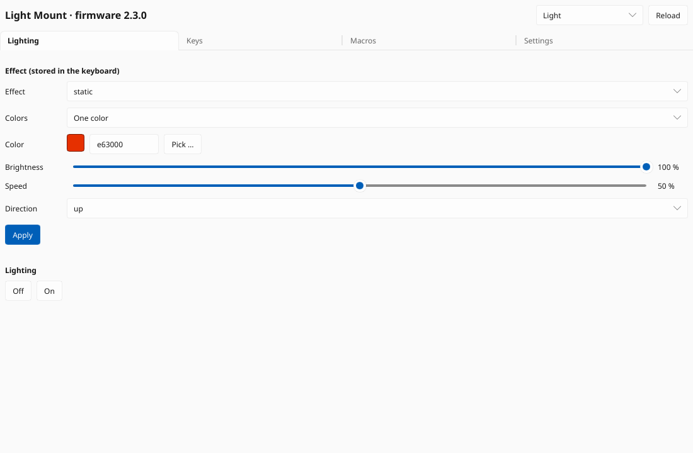
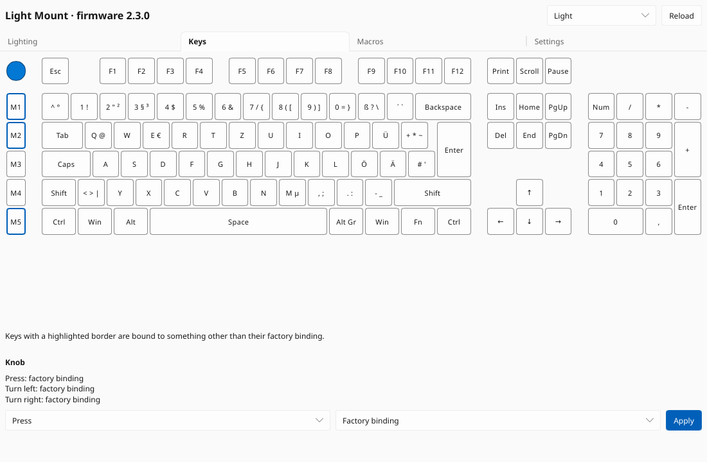
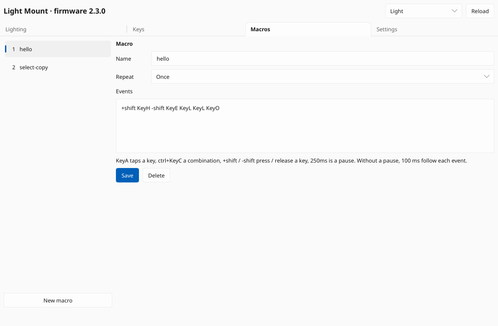
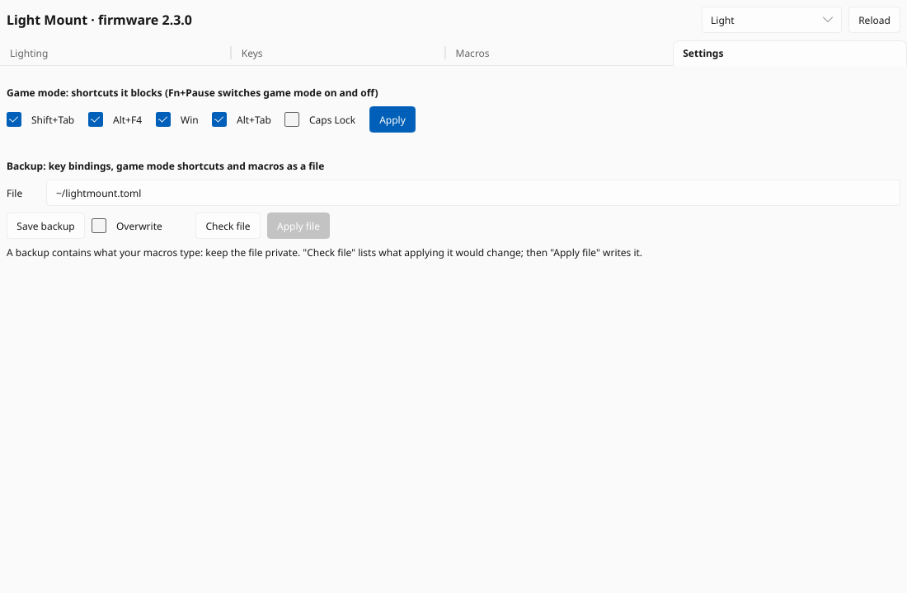

# Graphical interface

`quietlinux-gui` shows the keyboard and changes its lighting, key bindings and
macros. It uses the same library as the command line tool, so everything it
does is described in more detail in [usage-cli.md](usage-cli.md).

```sh
quietlinux-gui            # the connected Light Mount
quietlinux-gui --demo     # a simulated keyboard: try everything without changing yours
```

The window reads the keyboard when it opens and after every change (**Reload**
reads it again). While a change is being sent, the status line at the bottom
says "Working …"; errors appear there in red. The window does not watch key
presses.

The box next to **Reload** chooses the light or dark theme, or the system's.
The choice is saved in `~/.config/quietlinux/gui.toml`.

On a firmware version QuietLinux was not tested with, the title says
"read-only" and every change is refused, like the command line without
`--allow-unknown-firmware`.

## Lighting



- **Effect**, **Colors**, **Brightness**, **Speed** and **Direction** as in
  `quietlinux light effect`. Colors are six hex digits (`e63000`); "Rainbow" is
  IO Center's color gradient.
- **Pick …** (or a click on the swatch) opens a color wheel: the hue around
  the circle, pale colors towards the center; the slider below sets how bright
  the color is.
- **Apply** stores the effect in the keyboard. The Light Mount does not
  report its effect, so the tab shows what you set last, not what the keyboard
  shows.
- **Off** / **On** switch the lighting off and on, like IO Center's switch. The
  effect stays stored.

## Keys



Click a key to see what it does, normally and with Fn held. Keys with a
highlighted border are bound to something other than their factory binding.
The legends follow the layout the keyboard reports (German, UK or French ISO).

To change a key, choose the layer (**Normal** or **With Fn**; for the knob
**Press**, **Turn left** or **Turn right**), what it should do, and a value,
then **Apply**:

| Choice | Value |
|---|---|
| Factory binding | (none) |
| Key or combination | as in `bind KEY key`, e.g. `ctrl+KeyC`, `F13` |
| Media, Mouse button, Lighting | from the list |
| Macro | one of the macros stored in the keyboard |
| Disabled | (none) |

Fn cannot be bound. Enter can only be changed with the command line
(`quietlinux bind --force Enter …`), so that it is not changed by mistake.

## Macros



The list shows the macros stored in the keyboard. Select one to change its
name, repeat mode or events, then **Save**; **New macro** starts an empty one,
**Create** stores it. **Delete** is refused while a key is bound to the macro.

Events use the syntax of `quietlinux macro create`: `KeyA` taps a key,
`ctrl+KeyC` a combination, `+shift` / `-shift` press / release a key, `250ms` is
a pause. Without a pause, 100 ms follow each event.

Every change writes all macros again and reads them back to check (the
keyboard has no other way), as described in
[usage-cli.md](usage-cli.md#macro-list--show--create--edit--delete).

## Settings



- **Game mode**: the shortcuts game mode blocks, as `quietlinux game-mode
  --block`. Fn+Pause switches game mode on and off.
- **Backup**: the file of `quietlinux backup` and `apply` (key bindings, game
  mode shortcuts, macros; see [usage-cli.md](usage-cli.md#backup-file---force)).
  **Save backup** writes it; an existing file only with **Overwrite**.
  **Check file** lists what applying it would change, without writing; only
  then **Apply file** writes it. `~/` is your home folder. The file contains
  what your macros type: keep it private.

## Not in the window yet

Per-key colors (`light set`) and recording macros by typing them: see
[todo.md](todo.md).
